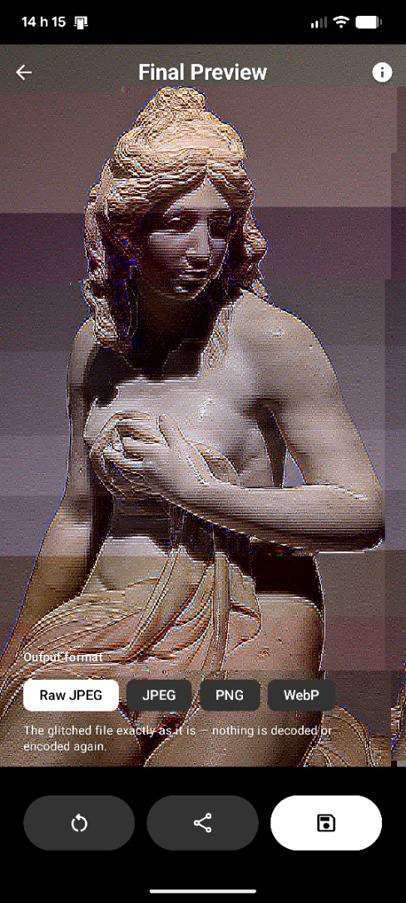

# JPEGlitch

An Android app for making JPEG glitches on purpose, by editing the parts of a
JPEG that decide what the picture looks like rather than by corrupting it at
random: the quantization tables, the Huffman tables, and the encoded scan data.

<p align="center">
  
  <br>
  <em>The Final Preview: the glitched picture, and what the file can leave as.</em>
</p>

## Downloads

The easiest way to get JPEGlitch is by grabbing the latest release directly from
GitHub or by adding it to Obtainium.

<div align="center">
  <a href="https://github.com/JustinMichaudOuellette/glitch/releases/latest"></a>
  <a href="https://apps.obtainium.imranr.dev/redirect?r=obtainium://app/%7B%22id%22%3A%22ca.justinmo.glitch%22%2C%22url%22%3A%22https%3A%2F%2Fgithub.com%2FJustinMichaudOuellette%2Fglitch%22%2C%22author%22%3A%22JustinMichaudOuellette%22%2C%22name%22%3A%22JPEGlitch%22%2C%22preferredApkIndex%22%3A0%2C%22additionalSettings%22%3A%22%7B%5C%22includePrereleases%5C%22%3Atrue%2C%5C%22fallbackToOlderReleases%5C%22%3Atrue%2C%5C%22filterReleaseTitlesByRegEx%5C%22%3A%5C%22%5C%22%2C%5C%22filterReleaseNotesByRegEx%5C%22%3A%5C%22%5C%22%2C%5C%22verifyLatestTag%5C%22%3Afalse%2C%5C%22sortMethodChoice%5C%22%3A%5C%22date%5C%22%2C%5C%22useLatestAssetDateAsReleaseDate%5C%22%3Afalse%2C%5C%22releaseTitleAsVersion%5C%22%3Afalse%2C%5C%22trackOnly%5C%22%3Afalse%2C%5C%22versionExtractionRegEx%5C%22%3A%5C%22%5C%22%2C%5C%22matchGroupToUse%5C%22%3A%5C%22%5C%22%2C%5C%22versionDetection%5C%22%3Atrue%2C%5C%22releaseDateAsVersion%5C%22%3Afalse%2C%5C%22useVersionCodeAsOSVersion%5C%22%3Afalse%2C%5C%22apkFilterRegEx%5C%22%3A%5C%22%5C%22%2C%5C%22invertAPKFilter%5C%22%3Afalse%2C%5C%22autoApkFilterByArch%5C%22%3Atrue%2C%5C%22appName%5C%22%3A%5C%22JPEGlitch%5C%22%2C%5C%22appAuthor%5C%22%3A%5C%22JustinMichaudOuellette%5C%22%2C%5C%22shizukuPretendToBeGooglePlay%5C%22%3Afalse%2C%5C%22allowInsecure%5C%22%3Afalse%2C%5C%22exemptFromBackgroundUpdates%5C%22%3Afalse%2C%5C%22skipUpdateNotifications%5C%22%3Afalse%2C%5C%22about%5C%22%3A%5C%22%5C%22%2C%5C%22refreshBeforeDownload%5C%22%3Afalse%7D%22%2C%22overrideSource%22%3A%22GitHub%22%7D"></a>
</div>

It ships with the Python tools and the measurements the app was built from. The
two reference documents are the interesting part of this repository:

| document | what it is |
|---|---|
| [`DQT.md`](DQT.md) | every quantization-table bit, what flipping it does, and which ones do nothing |
| [`DHT.md`](DHT.md) | the same for the Huffman tables, measured from a 3328-bit sweep of four photos |

## The flow

```
Source  ->  Resize  ->  Quantization table  ->  Scan  ->  Preview  ->  export
 pick       crop/scale   retune the numbers    flip bits   save or share

                                     Huffman table
                                  (the Scan title's triangle)
```

The quantization screen sits before the scan because it sets how the picture is
stored before bits are flipped in it. Every step is skippable.

The Huffman table is the third aimable edit and the one screen that is *not* a
step on that path: it is opened from the triangle on the Scan screen's title,
and it is a detour in both directions - backing out of it returns to the scan
with nothing applied, and confirming it carries on to the Preview, as the next
button of a step does. It is opened from the scan rather than anywhere later
because that is the step whose file it edits - the picture with the flips
already in it - and rewriting what each code means is the deepest of the three
edits, which most pictures do not need.

| screen | what it does |
|---|---|
| **Source** | camera, gallery, or an image shared into the app from another app |
| **Resize** | scale to a target width and frame the crop (No crop, 1:1 or 9:16) by dragging and pinching the picture; whatever is outside the bright frame is left out |
| **Quantization table** | pick one of eight pattern families (brightness, saturation, vertical, horizontal, checkered - each in luma and color) and retune the quantizers that draw it |
| **Scan** | flip bits in the scan data, aimed at a row band, with restart markers to bound how far one bad bit travels. Its title carries a triangle that opens the Huffman table |
| **Huffman table** | reached from that triangle, and its next button goes on to the Preview. Edit what each code means. Each code carries a strip of eight cells colored by what the sample sweep measured for that bit - grey changed nothing, green was one the sweep kept, red was filed as a wreck. Tapping a cell flips that bit, red or not: the strip labels, it never blocks |
| **Preview** | look at the whole result, choose what file the bytes leave as (raw JPEG, re-encoded JPEG, PNG or WebP), then share or save it |

Exports go to `Pictures/Glitch/`, and can also be shared straight out.

## Building

You need the Android SDK with **platform 37**, **NDK 28.2.13676358** and
**CMake 3.22.1** - the last two because the app builds its own JPEG codec. The
Gradle wrapper brings its own Gradle.

```sh
./gradlew assembleDebug
./gradlew installDebug          # with a device or emulator attached
```

**Nothing else to install.** The first build fetches
[libjpeg-turbo](https://github.com/libjpeg-turbo/libjpeg-turbo) at tag `3.0.1`
and compiles it once per ABI - a few seconds each, then cached - so cloning this
repository and building is the whole setup: there is no Maven dependency for it
and no submodule to remember. `app/src/main/cpp/CMakeLists.txt` explains why the
fetch is an `ExternalProject_Add` (upstream refuses to be a subproject), and why
it is pinned to this tag.

Building without network, or from a checkout you already have:

```sh
# PowerShell
$env:JPEGPIPE_LIBJPEG_TURBO_DIR = "C:\src\libjpeg-turbo"
./gradlew assembleDebug
```

## Tests

```sh
./gradlew :app:testDebugUnitTest        # 51 JVM tests: parsers, tables, sweep data, panel grouping
./gradlew :app:connectedDebugAndroidTest  # 14 on-device tests: the codec against Pillow, plus a benchmark
```

The JVM suite runs without a device. A few of its cases read a sample JPEG
(`a.jpg`, `b.jpg`) from the repository root and skip themselves when it is not
there, so the suite stays runnable in any checkout.

### What the on-device tests are for

The app decodes and encodes JPEG with its own build of libjpeg-turbo rather than
with the platform's, so that a flipped bit produces the same picture on every
device - and so that the `b_x4` sweep's classification still describes what the
app shows. The instrumentation tests hold that claim to account against fixtures
written by Pillow, which is the same library the sweep was measured with:

```
libjpeg-turbo 3.0.1
decode vs Pillow          0 of 27,648 pixels differ
encode vs Pillow          byte for byte identical
Lanczos resize vs Pillow  worst 1 level, 0 pixels over 2
resize preview vs Pillow  worst 1 level
the wired pipeline        mean 1.46 through the q92 round trip
PNG import -> our JPEG    mean 0.003
a bit the sweep calls fatal  refused, as the classification says
```

The fixtures live in `app/src/androidTest/assets/parity/` and are committed as
binaries. They are regenerated (needs Pillow) with:

```sh
python tools/make_parity_fixtures.py
python tools/add_png_fixture.py
```

Moving the pinned libjpeg-turbo tag means re-running those tests: they are what
makes "3.0.1" a verified claim rather than a copied one.

### What the benchmark is for

`JpegPerfTest` decodes, resizes and encodes a generated 2560x1920 photo through
both codecs and logs what each costs:

```sh
adb logcat -d -s JpegPerf:I
```

It is a benchmark, not a gate - the assertion is only that every path produced
something sane. It exists because the native library is built by this
repository's own CMake, and the failure mode that produces no wrong pixels and no
error message is building it unoptimised: everything works, and is simply several
times slower than the platform decoder it replaced.

A Pixel 7a (arm64), 2560x1920, best of three runs, against the platform codec
doing the equivalent job on the same phone:

```
                               ours    platform
decode, full size            55.0 ms    44.3 ms
decode, preview cap 1400     90.3 ms    40.8 ms   (platform: 1/2 decode + Skia scale)
resize (decode+Lanczos+q92)  63.1 ms
encode q92                   45.5 ms    83.3 ms
```

For scale: the same preview took **995.8 ms** before any of this work, on the
x86_64 emulator, where the platform path took 13-16 ms. Four things were wrong, in
descending order of cost - a native build with no `-O` flag at all, no SIMD, a
resampler that recomputed its `sin()` weights inside the innermost loop, and one
core doing the resampling while the phone's others idled. Anything back in the
hundreds of milliseconds per preview means one of them has returned;
`app/src/main/cpp/CMakeLists.txt` and the resampler in `jpeg_pipe.c` are where to
look.

The remaining distance to the platform column is not a defect to hunt: that
column decodes at half size and resamples with Skia's bilinear scaler, while ours
decodes the whole photo and runs a twelve-tap Lanczos over it, which is the
picture the `b_x4` sweep measured.

### How the resampler works

It is fixed point - int16 coefficients summing to exactly `1 << 14`, int32
accumulation, one rounding at the end - rather than floating point. That is what
Pillow's LANCZOS does, so the two agree by construction (`worst 1 level, 0 of 6912
pixels over 2`), and it is also the only way to have both a vector kernel and one
answer: integer addition is exact and associative, so the Neon path and the
scalar path return the same pixels to the last bit, and so would any future
rewrite of either.

Each pass works on one channel at a time, de-interleaved into planes, which is
what makes the taps contiguous enough to load eight at once. The two passes are
shaped differently on purpose: a horizontal pass reduces eight taps into one
output sample, while a vertical pass broadcasts one coefficient against a whole
row of them, because on a plane the second shape needs no horizontal reduction at
all. Rows are handed out in slices to up to four threads; a phone's cores are not
equal and the app runs in a cpuset of two fast cores and four slow ones, so a
fixed split leaves the fast ones idle while the slow ones finish.

## The Python tools

Older than the app and still the fastest way to explore a region. All three want
Pillow (`pip install pillow`).

```sh
python jpg_glitch.py b.jpg
```

Shows the file in a window; `1`-`4` choose the region (DQT, DHT, scan data,
restart markers), `SPACE` flips one random bit and re-renders, `Z` undoes, `S`
saves, `R` resets. Undecodable and invisible flips are rolled back and retried.

```sh
python jpg_batch_glitch.py b.jpg e.jpg f.jpg g.jpg
python jpg_batch_glitch.py *.jpg -r dht        # one region only
python jpg_batch_glitch.py b.jpg e.jpg -w 720  # smaller copies
```

Walks one table bit at a time and writes a side-by-side composite per bit:
`b_x4_DHT_1080w_bit00141.jpg` - one panel per source file, left to right, named
after the bit that was flipped. It also writes `sources.csv` and `manifest.csv`
recording exactly which byte and bit each panel had flipped and whether it
decoded - which is how the sweeps behind `DQT.md` and `DHT.md` were built, and
how the app's sample batches can be rebuilt.

```sh
python png_glitch.py image.png
```

The PNG counterpart, with eight targets: scanline bits, filter bytes, single
rows, MSB-only, LSB-only, raw IDAT bytes, the palette, and auxiliary chunks. It
decodes IDAT to its filtered scanline stream, flips a bit there and re-compresses,
because a flip in a deflate stream almost always breaks inflate outright.

## Layout

```
app/                          the Android app
  src/main/java/.../          Compose screens, and jpeg/ for the file-format work
  src/main/cpp/               our JPEG codec over libjpeg-turbo (fetched, not vendored)
  src/test/                   JVM tests
  src/androidTest/            on-device tests, and the Pillow fixtures they compare against
tools/                        regenerates the parity fixtures
assets/images/                the badges the README's download buttons use
jpg_glitch.py                 interactive single-file glitcher
jpg_batch_glitch.py           table sweeps, one composite per bit
png_glitch.py                 the PNG glitcher
DQT.md  DHT.md                bit-by-bit measurements of the two table regions
screenshot.png                the README's picture of the app
```

## License

This project is licensed under the **GNU General Public License v3.0 (GPL-3.0-only)** - see the [LICENSE](LICENSE) file for details.

## Author

**Justin Michaud-Ouellette** - [justinmo.ca](https://justinmo.ca)
